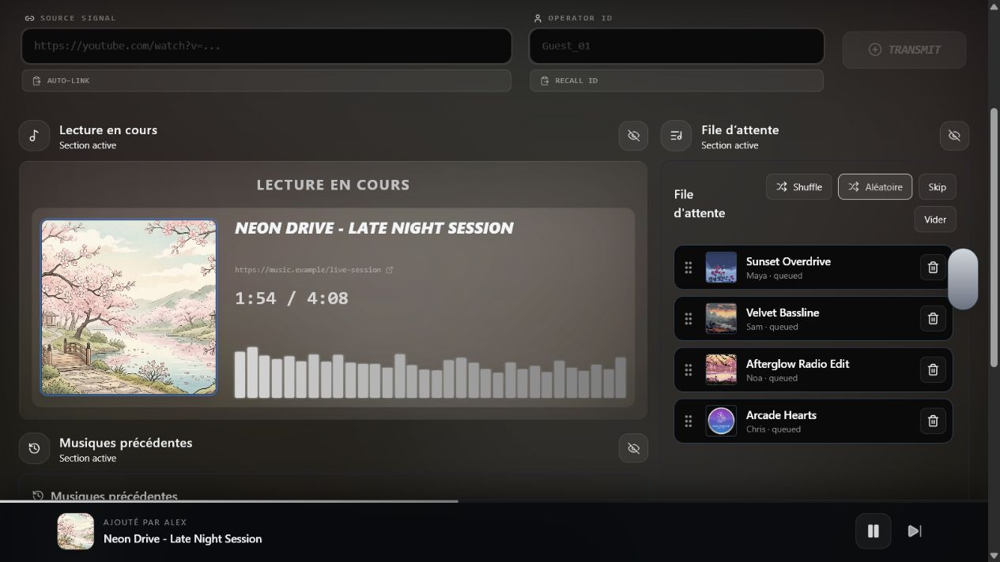
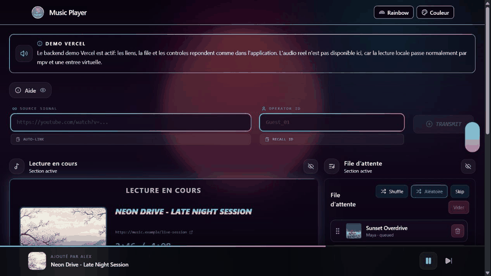
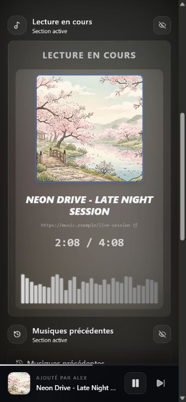

<p align="center">
  
</p>

<h1 align="center">Music Bot</h1>

<p align="center">
  Interface web moderne pour piloter un bot musical local, gérer une file d'attente partagée et router l'audio vers une entrée virtuelle.
</p>

<p align="center">
  
  
  
  
</p>

## Aperçu

<p align="center">
  
</p>

Music Bot est pensé pour une écoute locale complète: le frontend sert de panneau de contrôle, le backend résout les liens audio, pilote `mpv`, garde la file synchronisée en temps réel et bloque la lecture si le routage audio virtuel n'est pas prêt.

La démo Vercel existe seulement pour montrer l'interface depuis un lien web. Le vrai audio reste volontairement local, via `mpv` et une entrée virtuelle.

## Galerie

<p align="center">
  
</p>

<p align="center">
  
</p>

## Fonctionnalités

- Contrôle en temps réel avec Socket.IO: lecture, pause, reprise, skip, précédent, repeat, seek et vidage de file.
- File d'attente réordonnable avec historique, réajout rapide et mode aléatoire.
- Résolution de sources YouTube, SoundCloud, Spotify, Twitch, liens directs et recherche texte.
- Profils audio `balanced` et `xbox`, avec application côté `mpv`.
- Préchargement des pistes suivantes pour réduire les coupures.
- Routage audio virtuel obligatoire pour éviter une sortie involontaire sur les haut-parleurs système.
- Thèmes visuels animés: Retrowave, Aventurier, Floral Dream, Dark Room et Rainbow.
- Mode partage avec Cloudflare Tunnel pour que des amis puissent contrôler l'interface web.
- Démo Vercel isolée, sans écraser le build local servi par le backend.

## Démarrage rapide

Installe les dépendances du backend et du frontend:

```bash
npm run setup
```

Lance le bot complet avec backend local, frontend et tunnel Cloudflare:

```bash
npm run dev
```

Pour le moment, c'est le mode de partage recommandé: Cloudflare donne une URL random `trycloudflare.com` gratuite à chaque lancement, sans domaine acheté.

Lance seulement en local, sans tunnel:

```bash
npm run dev:local
```

Lance avec un tunnel Cloudflare nommé/stable après la configuration initiale, seulement si tu possèdes un domaine:

```bash
npm run dev:stable-tunnel
```

Le backend répond sur `http://localhost:4000`. Le frontend démarre sur `http://localhost:5173` ou sur le prochain port libre. Avec le quick tunnel, partage l'URL `trycloudflare.com` affichée dans le terminal; avec le tunnel stable, partage le hostname Cloudflare configuré.

## Tunnel Cloudflare

Le mode recommandé sans domaine acheté est:

```bash
npm run dev
```

Il utilise un quick tunnel `trycloudflare.com`; son URL change à chaque nouveau tunnel, mais c'est gratuit et suffisant pour partager temporairement l'app.

Pour partager une adresse fixe à un groupe, il faut posséder un domaine, créer un tunnel nommé et l'associer à un hostname Cloudflare.

Une seule fois:

```bash
npm run tunnel:login
npm run tunnel:create
npm run tunnel:route -- miss-noemie-music-bot.com
```

Remplace `miss-noemie-music-bot.com` par ton vrai hostname Cloudflare si tu changes de domaine. Ensuite, lance l'app avec:

```bash
npm run dev:stable-tunnel
```

Par défaut, le tunnel nommé s'appelle `music-bot`. Pour utiliser un autre nom, définis `CLOUDFLARE_TUNNEL_NAME` avant de lancer `npm run dev:stable-tunnel`.

Autorise les noms d'hôte de tes domaines personnalisés dans `frontend/.env.local`, séparés par des virgules, puis relance le lanceur:

```dotenv
VITE_ALLOWED_HOSTS=music.example.com,autre.example.com
```

Utilise des noms d'hôte sans protocole ni chemin. Les adresses locales et les quick tunnels `trycloudflare.com` restent autorisés par défaut.

La restriction facultative `BACKEND_ALLOWED_ORIGINS` se configure dans `backend/.env` avec des origines complètes, par exemple `https://music.example.com,http://localhost:5173`. Elle contrôle les origines HTTP/Socket.IO; `VITE_ALLOWED_HOSTS` contrôle les hôtes acceptés par le serveur de développement Vite. Adapte aussi cette liste si l'URL du tunnel ou le port du frontend change.

Configuration de référence des notes Windows du 20 août 2026:

- tunnel Cloudflare nommé: `music-bot`
- hostname stable prévu: `https://miss-noemie-music-bot.com`
- le domaine custom reste optionnel tant qu'on ne veut pas acheter/configurer un domaine; utilise `npm run dev` pour rester sur une URL random gratuite.

## Prérequis audio

Le mode local complet a besoin de:

- Node.js 22.12 ou plus récent et npm.
- `mpv` disponible dans le `PATH`, ou configuré avec `MPV_BIN`.
- Une route audio virtuelle prête avant la lecture.
- Windows: VoiceMeeter, avec le périphérique `WINDOWS_MPV_AUDIO_DEVICE` configuré au besoin.
- Linux: PulseAudio/PipeWire avec un sink virtuel, activable via les variables `LINUX_*`.
- Optionnel: `cloudflared` pour le partage web.

Le backend vérifie le routage au démarrage. Si l'entrée virtuelle n'est pas prête, l'interface affiche une alerte et la lecture est bloquée pour éviter une sortie audio système.

## Commandes utiles

```bash
npm run build:backend
npm run build:frontend
npm run build:frontend:vercel
npm test
npm run lint
npm run doctor
npm run update:ytdlp
```

Le build local du frontend écrit dans `frontend/dist`, qui est servi par le backend local. Le build Vercel écrit dans `frontend/dist-vercel` pour garder la démo séparée du vrai mode local.

## Démo Vercel

La démo Vercel est volontairement limitée:

- `api/demo.js` simule une file d'attente en mémoire.
- `frontend/src/hooks/useVercelDemoQueue.ts` remplace le client Socket.IO seulement en mode Vercel.
- `frontend/src/components/DemoAudioNotice.tsx` indique clairement que l'audio réel n'est pas disponible dans la démo.
- `vercel.json` publie uniquement `frontend/dist-vercel`.

```bash
npm --prefix frontend run build:vercel
```

Cette séparation est importante: le mode local doit continuer à servir `frontend/dist` et à utiliser le backend Socket.IO réel.

## Architecture

```text
.
|-- api/demo.js                         # Backend léger pour la démo Vercel
|-- backend/src/server.ts               # API HTTP, Socket.IO et routes de contrôle
|-- backend/src/player.ts               # Boucle de lecture, file, historique, préchargement
|-- backend/src/queue.ts                # Mutations de la file et de l'historique
|-- backend/src/diagnostics.ts          # Journal persistant et événements bornés
|-- backend/src/toolDiagnostics.ts      # Vérification des exécutables utilisés
|-- backend/src/providerCache.ts        # Cache persistant de correspondances entre fournisseurs
|-- backend/src/metrics.ts              # Mesures récentes des opérations du backend
|-- backend/src/mpv.ts                  # Pilotage mpv et profils audio
|-- backend/src/platforms/              # Détection YouTube, SoundCloud, Spotify, Twitch, direct
|-- frontend/src/App.tsx                # Composition de l'interface
|-- frontend/src/hooks/useLiveQueue.ts  # Client local Socket.IO ou client de démo Vercel
|-- frontend/src/components/            # Lecteur, file, historique, thèmes, alertes
|-- shared/                             # Types et horloge communs
`-- scripts/dev.mjs                     # Lanceur local backend + frontend + Cloudflare
```

## Variables d'environnement

| Variable | Rôle |
| --- | --- |
| `PORT` | Port du backend (4000 par défaut). Avec le lanceur, passe-le dans son environnement (`PORT=4001 npm run dev:local`) pour synchroniser le backend et le proxy Vite. |
| `CLOUDFLARE_TUNNEL_NAME` | Nom du tunnel Cloudflare utilisé par `dev:stable-tunnel`, `music-bot` par défaut. |
| `VITE_ALLOWED_HOSTS` | Noms d'hôte supplémentaires acceptés par Vite, séparés par des virgules; à définir dans `frontend/.env.local` ou l'environnement du lanceur. |
| `BACKEND_ALLOWED_ORIGINS` | Origines HTTP/Socket.IO autorisées, séparées par des virgules; une liste vide conserve le partage sans restriction d'origine. |
| `IDLE_SHUTDOWN_MS` | Délai d'arrêt après la déconnexion de tous les clients. Désactivé par défaut (`0`); `60000` rétablit l'ancien arrêt après une minute. |
| `MPV_BIN` | Chemin personnalisé vers `mpv`. |
| `AUDIO_PROFILE` | Profil audio par défaut: `balanced` ou `xbox`. |
| `WINDOWS_MPV_AUDIO_DEVICE` | Périphérique audio Windows utilisé par `mpv`. |
| `VOICEMEETER_PATH` | Chemin vers VoiceMeeter sur Windows. |
| `YTDLP_COOKIES_PATH` | Fichier cookies pour aider la résolution YouTube. |
| `YTDLP_BIN` | Exécutable yt-dlp personnalisé; sinon, le bot privilégie la copie installée dans le backend. |
| `PLAYER_PROVIDER_MATCH_CACHE_PATH` | Fichier du cache des correspondances, `backend/.data/provider-match-cache.json` par défaut. |
| `PLAYER_PROVIDER_MATCH_CACHE_MAX` | Nombre maximal de correspondances conservées, 1000 par défaut, plafonné à 10000. |
| `PLAYER_PROVIDER_MATCH_CACHE_TTL_MS` | Durée de validité d'une correspondance, 24 heures par défaut, plafonnée à 7 jours. |
| `SPOTIFY_CLIENT_ID` | Identifiant Spotify, si les liens Spotify sont utilisés. |
| `SPOTIFY_CLIENT_SECRET` | Secret Spotify. |
| `SPOTIFY_REFRESH_TOKEN` | Autorisation utilisateur Spotify. Les titres et albums peuvent utiliser les identifiants de l'application; l'accès aux playlists dépend des droits utilisateur et du mode de l'application. |
| `SPOTIFY_MARKET` | Marché Spotify sur deux lettres, `FR` par défaut. Utilise `CA` pour le catalogue canadien. |
| `LINUX_ENABLE_VIRTUAL_SINK` | Crée le sink virtuel automatiquement par défaut. Avec `false`, un sink existant portant le nom configuré reste utilisable. |
| `LINUX_VIRTUAL_SINK_NAME` | Nom du sink Linux, `xmbot_sink` par défaut; sa source `.monitor` doit être présente. |
| `DIAGNOSTICS_ENABLED` | Journal persistant activé par défaut; `false` conserve uniquement les événements en mémoire. |
| `DIAGNOSTICS_LOG_DIR` | Dossier du journal, `.data/logs` à la racine du projet par défaut. |
| `DIAGNOSTICS_MAX_BYTES` | Taille maximale par fichier de journal, 1 Mio par défaut; trois fichiers au maximum. |

Le bot continue à jouer lorsque le navigateur se ferme ou que le tunnel se reconnecte. En cas de sortie de mpv ou d'absence de progression pendant 60 secondes hors pause, le lecteur tente une fois de relancer la piste avec une URL fraîche, puis passe à la suivante si elle échoue encore. Une reprise automatique recommence la piste au début.

Les appels Spotify et les résolutions de médias ont des délais limités. Certaines playlists Spotify peuvent être refusées par l'API même si leur page web est publique; consulte les [conditions d'accès de Spotify](https://developer.spotify.com/documentation/web-api/reference/get-playlists-items).

`GET /health` expose l'état du routage audio, le nombre de clients et la longueur de la file pour faciliter le diagnostic. Le [rapport d'audit](docs/AUDIT.md) détaille les corrections, les tests et les limites restantes.

`GET /metrics` renvoie les 100 dernières mesures d'opérations du backend, avec leur durée et leur résultat. Ces mesures restent en mémoire jusqu'au redémarrage; les journaux persistants sont disponibles séparément dans les diagnostics.

Le cache de correspondances conserve les pages YouTube trouvées pour Spotify et les replis SoundCloud. Il se recharge au démarrage depuis `backend/.data/provider-match-cache.json`, ignoré par Git. Les URL audio temporaires ou signées restent exclues du fichier; chaque lecture peut obtenir un nouveau flux. Le cache ne sauvegarde ni la file ni l'historique.

Le panneau **Diagnostic du bot** affiche l'état du serveur, de mpv et du routage, les erreurs récentes et le chemin exact des outils. Il se rafraîchit uniquement lorsqu'il est ouvert et que l'onglet est visible. Un export JSON permet de conserver un relevé pour un diagnostic.

`npm run doctor` vérifie les versions des exécutables réellement configurés. `npm run update:ytdlp` met à jour cette copie de yt-dlp explicitement, y compris celle installée dans le backend; la commande nécessite une connexion réseau et les droits d'écriture sur l'exécutable. Aucune mise à jour automatique n'est effectuée pendant la lecture. Voir le [guide de diagnostic](docs/DIAGNOSTICS.md).

## Notes de développement

- Le backend local sert `frontend/dist`.
- La démo Vercel sert `frontend/dist-vercel`.
- Ne mélange pas ces deux sorties de build: c'est ce qui protège le vrai chemin audio local.
- Les captures du README utilisent des données de démonstration pour montrer l'interface sans lancer de lecture réelle.
